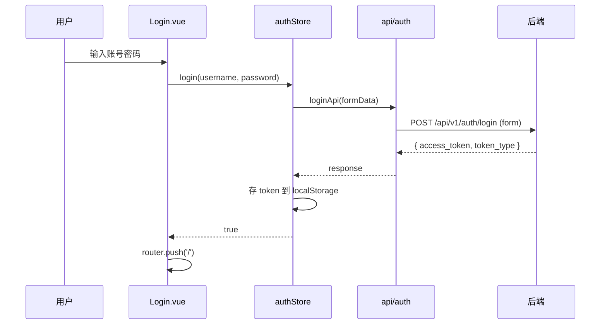

# 前端软件设计文档 (SDD)

版本：v1.0
日期：2026-10-18
技术栈：Vue 3.4 + TypeScript 5 + Vite 5 + Element Plus 2 + Axios 1 + Vue Router 4 + Pinia 2

## 1. 设计概述

### 1.1 设计背景

- 后端已完成：FastAPI + SQLAlchemy + MySQL，提供 `/api/v1` 前缀的 RESTful 接口
- 后端地址：http://127.0.0.1:8002
- 统一响应格式：`{ code, msg, data }`，`code` 为 `0` 表示成功
- 鉴权：JWT，登录后 token 存 localStorage，请求头 `Authorization: Bearer <token>`
- 已有接口文档：`docs/01-数据库设计.md` 至 `docs/07-销售出库模块接口文档.md`
- 登录接口特殊说明：`POST /api/v1/auth/login` 使用 OAuth2 表单提交（`username`/`password`），成功后直接返回 `{ "access_token": "...", "token_type": "bearer" }`，**不**使用 `{code, msg, data}` 包装，以兼容 Swagger UI 的 OAuth2 密码流

### 1.2 设计目标

- 提供完整的进销存业务操作界面
- 后台管理系统标准布局（侧边栏 + 顶栏 + 内容区）
- 响应式表格、表单校验、分页、筛选
- 仪表盘数据可视化

### 1.3 设计原则

- 组件化、模块化
- API 请求集中封装
- 路由懒加载
- 统一错误处理

## 2. 技术选型

| 层次 | 选型 | 理由 |
| --- | --- | --- |
| 构建工具 | Vite 5 | 冷启动快、HMR 快 |
| 框架 | Vue 3.4 (Composition API + `<script setup>`) | 生态成熟、上手快 |
| 语言 | TypeScript 5 | 类型安全 |
| UI 库 | Element Plus 2 | 后台管理系统标配 |
| 路由 | Vue Router 4 | 官方路由、支持守卫 |
| 状态管理 | Pinia 2 | 官方推荐、DevTools 支持 |
| HTTP | Axios 1 | 拦截器机制完善 |
| 图表 | ECharts 5 (通过 vue-echarts) | 报表可视化 |
| 代理 | Vite devServer proxy | 开发环境免跨域 |

## 3. 系统架构

### 3.1 整体架构图

```
浏览器 (localhost:3000)
      │
      ▼
Vue 3 应用 (frontend/)
      │  /api/* 请求
      ▼
Vite devServer proxy (:3000)
      │  转发到 http://127.0.0.1:8002
      ▼
FastAPI 后端 (main:app, :8002)
      │  SQLAlchemy 2.x
      ▼
MySQL (inventory)
```

### 3.2 目录结构

```
frontend/
├── vite.config.ts
├── tsconfig.json
├── tsconfig.node.json
├── index.html
├── package.json
├── env.d.ts
└── src/
    ├── api/
    │   ├── request.ts          # Axios 实例 + 拦截器
    │   ├── auth.ts             # 登录/注册
    │   ├── inventory.ts        # 库存余额/流水
    │   ├── purchase.ts         # 采购订单/入库单
    │   ├── sales.ts            # 销售订单/出库单
    │   └── reports.ts          # 报表统计
    ├── types/
    │   └── index.ts            # 全部 TypeScript 接口定义
    ├── stores/
    │   └── auth.ts             # Pinia 鉴权 store
    ├── router/
    │   └── index.ts            # 路由表 + 全局守卫
    ├── components/
    │   └── Layout.vue          # 侧边栏 + 顶栏 + 内容区
    ├── views/
    │   ├── Login.vue
    │   ├── Dashboard.vue
    │   ├── inventory/
    │   │   ├── StockList.vue
    │   │   └── StockMovement.vue
    │   ├── purchase/
    │   │   ├── PurchaseOrders.vue
    │   │   └── PurchaseCreate.vue
    │   ├── sales/
    │   │   ├── SalesOrders.vue
    │   │   └── SalesCreate.vue
    │   └── reports/
    │       ├── InventoryMovements.vue
    │       ├── LowStockAlerts.vue
    │       ├── PurchaseSummary.vue
    │       └── SalesSummary.vue
    ├── utils/
    │   └── auth.ts             # token 存取 / JWT 解码
    ├── App.vue
    └── main.ts
```

### 3.3 分层说明

- `views/`：页面级组件，只做数据获取和组合
- `components/`：可复用 UI 组件
- `api/`：接口封装层，统一走 `request.ts` 的 Axios 实例
- `stores/`：状态管理层（Pinia）
- `router/`：路由配置与守卫
- `utils/`：工具函数（token 管理、JWT 解码等）

## 4. 模块设计

### 4.1 模块清单

| 模块 | 路由路径 | 功能说明 |
| --- | --- | --- |
| 认证 | /login | 登录 |
| 仪表盘 | /dashboard | 核心指标展示 |
| 库存列表 | /inventory | 商品库存余额查询 |
| 库存流水 | /inventory/movements | 出入库记录 |
| 采购订单 | /purchase | 采购单列表 |
| 新建采购 | /purchase/create | 创建采购单 |
| 销售订单 | /sales | 销售单列表 |
| 新建销售 | /sales/create | 创建销售单 |
| 流水汇总 | /reports/inventory-movements | 库存流水报表 |
| 低库存预警 | /reports/low-stock | 低于阈值的商品 |
| 采购统计 | /reports/purchase | 采购金额统计 |
| 销售统计 | /reports/sales | 销售金额统计 |

### 4.2 接口映射表

> 全部接口以实际后端为准。除登录接口外，成功响应均为 `{ code: 0, msg, data }`。

| 模块 | 方法 | 路径 | 说明 |
| --- | --- | --- | --- |
| 登录 | POST | /api/v1/auth/login | 用户登录（form-data，返回 `{access_token, token_type}`） |
| 注册 | POST | /api/v1/auth/register | 用户注册 |
| 库存余额 | GET | /api/v1/inventory/balances | 分页查询库存余额（skip/limit） |
| 库存流水 | GET | /api/v1/inventory/movements | 查询出入库流水（skip/limit） |
| 采购订单列表 | GET | /api/v1/purchases/orders | 分页查询采购订单 |
| 新建采购 | POST | /api/v1/purchases/orders | 创建采购订单 |
| 采购入库单 | GET | /api/v1/purchases/ins | 采购入库单列表 |
| 销售订单列表 | GET | /api/v1/sales/orders | 分页查询销售订单 |
| 新建销售 | POST | /api/v1/sales/orders | 创建销售订单 |
| 销售出库单 | GET | /api/v1/sales/outs | 销售出库单列表 |
| 低库存预警 | GET | /api/v1/reports/low-stock-alerts | 预警列表（page/page_size） |
| 采购统计 | GET | /api/v1/reports/purchase-summary | 采购金额统计（必填 start_date/end_date） |
| 销售统计 | GET | /api/v1/reports/sales-summary | 销售金额统计（必填 start_date/end_date） |
| 流水汇总 | GET | /api/v1/reports/inventory-movements | 流水汇总（page/page_size） |

### 4.3 数据模型（TypeScript 接口定义）

```ts
// 统一响应
export interface ApiResponse<T = any> {
  code: number
  msg: string
  data: T
}

// 鉴权
export interface LoginRequest {
  username: string
  password: string
}
export interface LoginResponse {
  access_token: string
  token_type: string
}
export interface User {
  id: number
  username: string
  is_active?: boolean
  created_at?: string
}

// 库存
export interface InventoryBalance {
  id: number
  product_id: number
  warehouse_id: number
  current_quantity: number
  product_name: string
  warehouse_name: string
  updated_at: string
  [key: string]: any
}
export interface StockMovement {
  id: number
  product_id: number
  warehouse_id: number
  movement_type: string
  quantity: number
  reference_type: string | null
  reference_id: number | null
  operator_id: number
  remark: string | null
  created_at: string
  product_name: string
  warehouse_name: string
  operator_name: string
  [key: string]: any
}

// 采购
export interface PurchaseOrder {
  id: number
  order_no: string
  supplier_id: number
  warehouse_id: number
  status: string
  total_quantity: number
  total_amount: number
  remark: string | null
  created_by: number
  approved_by: number | null
  created_at: string
  updated_at: string
  supplier_name: string
  warehouse_name: string
  items: any[]
  [key: string]: any
}

// 销售
export interface SalesOrder {
  id: number
  order_no: string
  customer_id: number
  warehouse_id: number
  status: string
  total_quantity: number
  total_amount: number
  remark: string | null
  created_by: number
  approved_by: number | null
  created_at: string
  updated_at: string
  customer_name: string
  warehouse_name: string
  items: any[]
  [key: string]: any
}

// 报表
export interface PageResult<T = any> {
  items: T[]
  total: number
  page: number
  page_size: number
}
export interface LowStockAlertItem {
  product_id: number
  product_name: string
  warehouse_id: number
  warehouse_name: string
  current_quantity: number
  alert_threshold: number
}
export interface PurchaseSummaryData {
  total_orders: number
  total_items: number
  total_amount: number
  total_quantity: number
  by_supplier: Array<{
    supplier_id: number
    supplier_name: string
    order_count: number
    total_amount: number
  }>
}
export interface SalesSummaryData {
  total_orders: number
  total_items: number
  total_amount: number
  total_quantity: number
  by_customer: Array<{
    customer_id: number
    customer_name: string
    order_count: number
    total_amount: number
  }>
}
```

### 4.4 组件设计

- `Layout.vue`：`el-container` + `el-aside`（侧边栏菜单）+ `el-header`（顶栏：用户名 + 退出下拉）+ `el-main`（`<router-view />`）
- 列表页通用模式：顶部 `el-form` 筛选区 + `el-table` + `el-pagination`
- 表单页通用模式：`el-form` 带校验规则 + 提交按钮 loading
- 图表页：`vue-echarts` 的 `v-chart` 组件渲染柱状图

## 5. 交互设计

### 5.1 登录流程（Mermaid 时序图）



### 5.2 路由守卫逻辑

- `to.meta.requiresAuth !== false` 且无 token → 重定向 `/login`
- 已登录（有 token）访问 `/login` → 重定向 `/`
- 响应拦截器收到 401 → 清 token + 用户信息 → 跳转 `/login`

### 5.3 错误处理策略

- 网络错误：`ElMessage.error('网络异常，请稍后重试')`
- 业务错误（`code !== 0`）：显示 `msg` 字段
- HTTP 401：自动登出并跳转登录页
- 其他 HTTP 错误：显示状态文本

## 6. 状态管理设计

Pinia store 清单：

- `auth` store：
  - state：`token`、`user`
  - actions：
    - `login(username, password)`：调用登录接口，存 token，解码 JWT 取用户名存 user
    - `logout()`：清空 token、user，跳转 `/login`
  - token 持久化到 localStorage，刷新后从 localStorage 恢复

## 7. 样式与主题

- 主色：`#409EFF`（Element Plus 默认）
- 布局：全屏高度 `100vh`
- 侧边栏：深色 `#304156`
- 内容区：浅灰背景 `#f0f2f5`
- 登录页：居中卡片 + 渐变背景

## 8. 非功能需求

- 首屏加载 < 3s
- 表格支持 1000+ 行（按需虚拟滚动）
- 响应式：支持 1366px 及以上

## 9. 开发规范

- 组件名 PascalCase
- 文件名 kebab-case（目录名小写复数，单文件组件 PascalCase）
- 接口路径统一 `/api/v1` 前缀
- TypeScript 类型标注完整，复杂结构用 `interface`
- 提交前 eslint / tsc 类型检查
